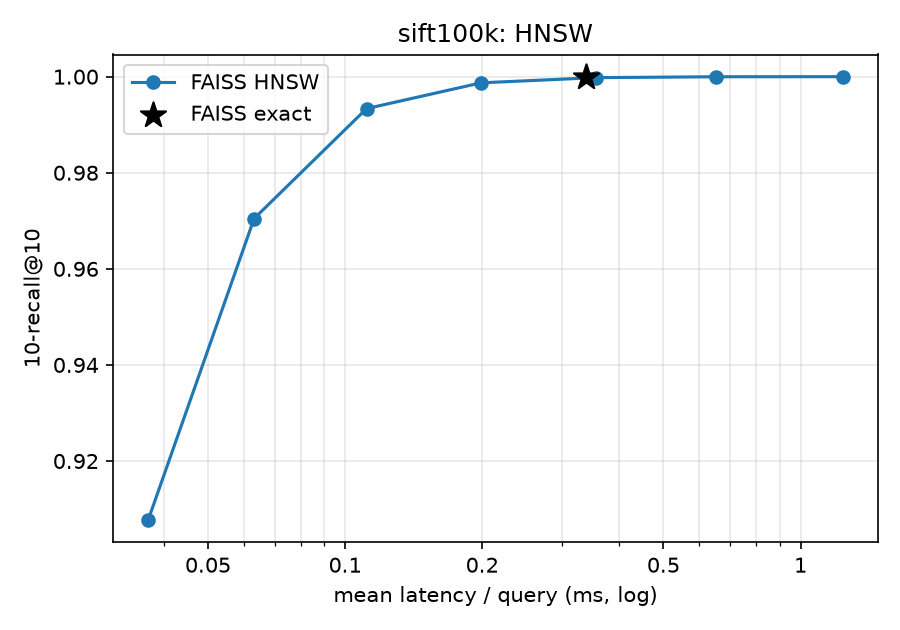
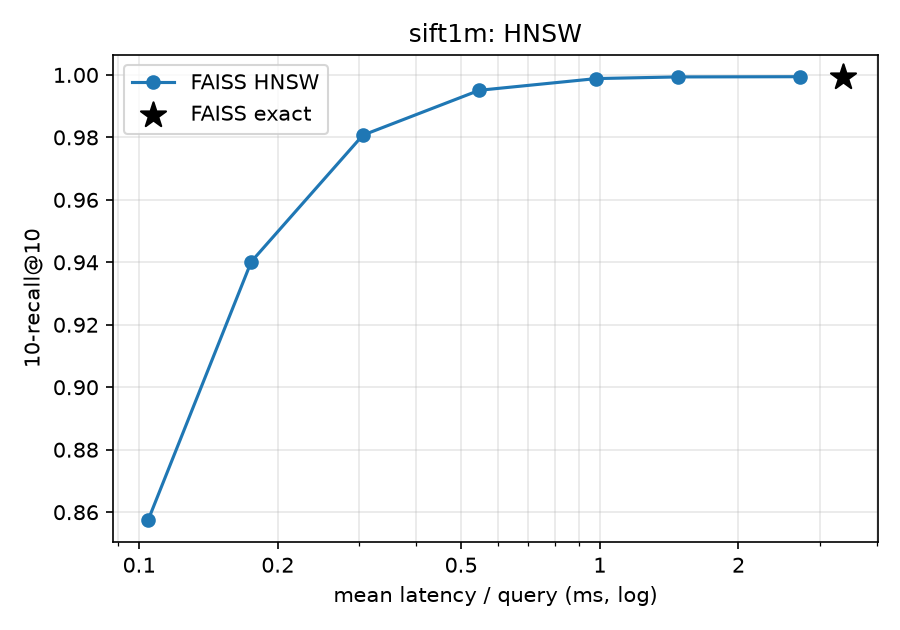
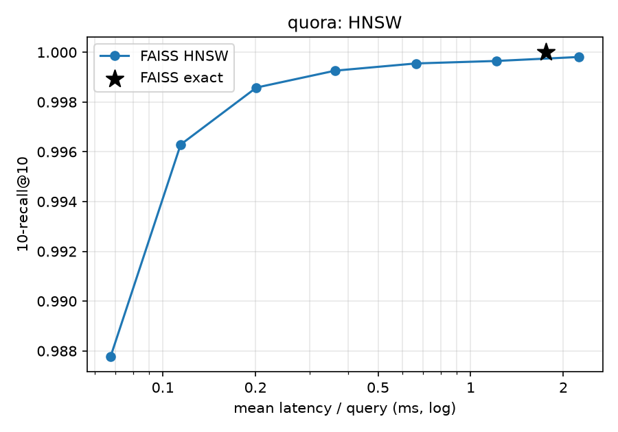
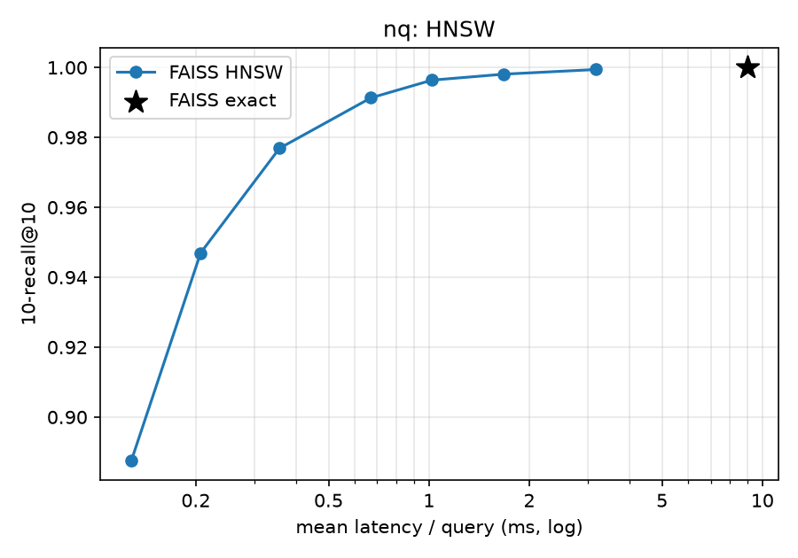
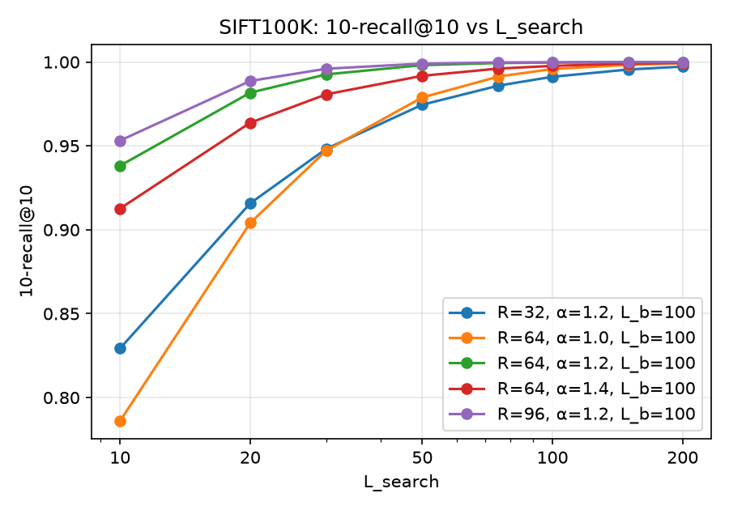
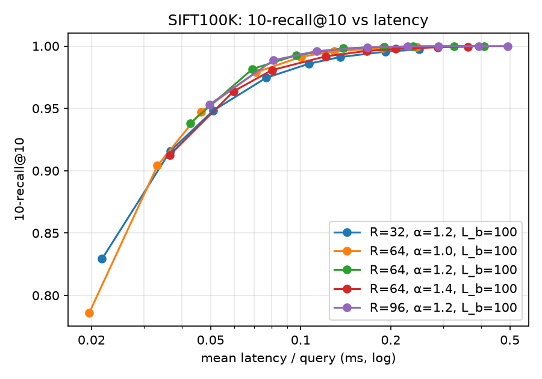
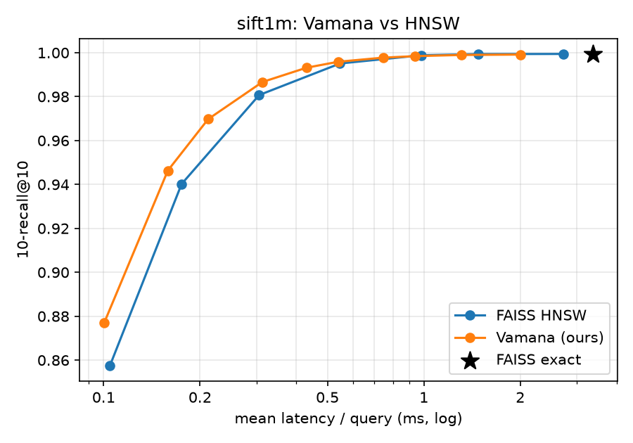
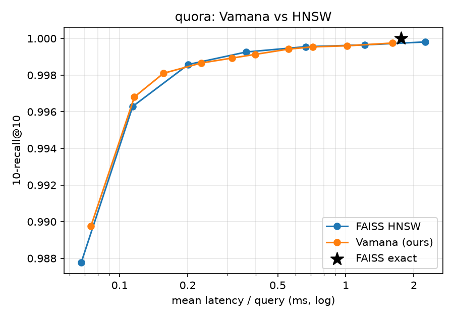
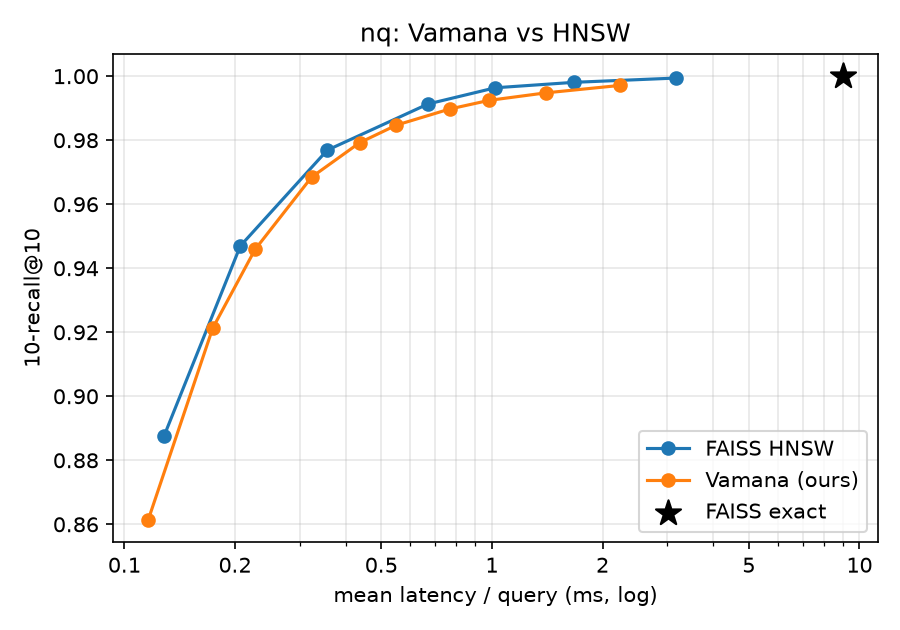

# Report tables (auto-generated by scripts/make_report_tables.py)


## System

- **hostname**: gpu1
- **cpu_model**: Intel(R) Xeon(R) Gold 5220R CPU @ 2.20GHz
- **logical_cpus**: 96
- **physical_cores**: 48
- **ram_gib**: 1510.5
- **python**: 3.12.15
- **os**: Linux-5.10.0-32-amd64-x86_64-with-glibc2.31
- **faiss**: 1.15.1
- **numba**: 0.68.0
- **numba_threads**: 96
- **numpy**: 2.5.3
- **sklearn**: 1.9.1
- **fincore_cli**: True

## Dataset summary

| dataset   |   corpus_size |   num_queries |   original_dim |   search_dim |   raw_128d_float32_MiB | pca_impl                                                                  | pca_sample   | pca_seed   | pca_var_explained   |
|:----------|--------------:|--------------:|---------------:|-------------:|-----------------------:|:--------------------------------------------------------------------------|:-------------|:-----------|:--------------------|
| sift1m    |       1000000 |         10000 |            128 |          128 |                  488.3 | -                                                                         | -            | -          | -                   |
| sift100k  |        100000 |         10000 |            128 |          128 |                   48.8 | -                                                                         | -            | -          | -                   |
| quora     |        522931 |         10000 |           1024 |          128 |                  255.3 | sklearn.decomposition.PCA(n_components=128, svd_solver='covariance_eigh') | 200000       | 42         | 0.6177              |
| nq        |       2681468 |          3452 |           1024 |          128 |                 1309.3 | sklearn.decomposition.PCA(n_components=128, svd_solver='covariance_eigh') | 200000       | 42         | 0.5991              |
| msmarco   |       8841823 |          6980 |           1024 |          128 |                 4317.3 | sklearn.decomposition.PCA(n_components=128, svd_solver='covariance_eigh') | 200000       | 42         | 0.6064              |

SIFT1M FAISS exact vs supplied ground truth: {'top1_exact_match': 0.9914, '10-recall@10_vs_supplied': 0.9994400000000001, '100-recall@100_vs_supplied': 0.999889}

## Part 1 — FAISS exact + HNSW


### sift100k

| method      | param                 |   1-recall@1 |   10-recall@10 |   mean_latency_ms |       qps |   build_time_s |   index_bytes |   latency_ms_single_query_mode |   timing_rel_spread |
|:------------|:----------------------|-------------:|---------------:|------------------:|----------:|---------------:|--------------:|-------------------------------:|--------------------:|
| faiss-exact | -                     |       1      |         1      |            0.3386 |  2953.32  |         0.0241 |      51200045 |                         4.1011 |              0.0099 |
| faiss-hnsw  | M=32,efC=200,efS=16   |       0.9472 |         0.9077 |            0.0369 | 27066.6   |         0.7221 |      78420834 |                       nan      |              0.0289 |
| faiss-hnsw  | M=32,efC=200,efS=32   |       0.985  |         0.9705 |            0.0631 | 15840.5   |         0.7221 |      78420834 |                       nan      |              0.0137 |
| faiss-hnsw  | M=32,efC=200,efS=64   |       0.9971 |         0.9934 |            0.1114 |  8972.98  |         0.7221 |      78420834 |                       nan      |              0.0198 |
| faiss-hnsw  | M=32,efC=200,efS=128  |       0.9996 |         0.9987 |            0.199  |  5025.46  |         0.7221 |      78420834 |                       nan      |              0.0123 |
| faiss-hnsw  | M=32,efC=200,efS=256  |       0.9998 |         0.9998 |            0.3558 |  2810.44  |         0.7221 |      78420834 |                       nan      |              0.0057 |
| faiss-hnsw  | M=32,efC=200,efS=512  |       1      |         1      |            0.6515 |  1535     |         0.7221 |      78420834 |                       nan      |              0.0022 |
| faiss-hnsw  | M=32,efC=200,efS=1024 |       1      |         1      |            1.2382 |   807.619 |         0.7221 |      78420834 |                       nan      |              0.0008 |



### sift1m

| method      | param                 |   1-recall@1 |   10-recall@10 |   mean_latency_ms |      qps |   build_time_s |   index_bytes |   latency_ms_single_query_mode |   timing_rel_spread |
|:------------|:----------------------|-------------:|---------------:|------------------:|---------:|---------------:|--------------:|-------------------------------:|--------------------:|
| faiss-exact | -                     |       0.9914 |         0.9994 |            3.368  |  296.909 |         0.2465 |     512000045 |                        41.0071 |              0.0056 |
| faiss-hnsw  | M=32,efC=200,efS=16   |       0.905  |         0.8575 |            0.1046 | 9557.11  |        22.4577 |     784129506 |                       nan      |              0.0081 |
| faiss-hnsw  | M=32,efC=200,efS=32   |       0.9587 |         0.9402 |            0.1752 | 5708.32  |        22.4577 |     784129506 |                       nan      |              0.0043 |
| faiss-hnsw  | M=32,efC=200,efS=64   |       0.9823 |         0.9807 |            0.306  | 3267.86  |        22.4577 |     784129506 |                       nan      |              0.0023 |
| faiss-hnsw  | M=32,efC=200,efS=128  |       0.9898 |         0.9951 |            0.5474 | 1826.7   |        22.4577 |     784129506 |                       nan      |              0.0014 |
| faiss-hnsw  | M=32,efC=200,efS=256  |       0.9912 |         0.9988 |            0.9833 | 1017.01  |        22.4577 |     784129506 |                       nan      |              0.0286 |
| faiss-hnsw  | M=32,efC=200,efS=512  |       0.9914 |         0.9994 |            1.4785 |  676.349 |        22.4577 |     784129506 |                       nan      |              0.0007 |
| faiss-hnsw  | M=32,efC=200,efS=1024 |       0.9914 |         0.9994 |            2.7241 |  367.096 |        22.4577 |     784129506 |                       nan      |              0.0011 |



### quora

| method      | param                 |   1-recall@1 |   10-recall@10 |   mean_latency_ms |       qps |   build_time_s |   index_bytes |   latency_ms_single_query_mode |   timing_rel_spread |
|:------------|:----------------------|-------------:|---------------:|------------------:|----------:|---------------:|--------------:|-------------------------------:|--------------------:|
| faiss-exact | -                     |       1      |         1      |            1.7565 |   569.33  |         0.1293 |     267740717 |                        21.2112 |              0.0029 |
| faiss-hnsw  | M=32,efC=200,efS=16   |       0.9949 |         0.9878 |            0.0677 | 14780.4   |        11.4118 |     410045510 |                       nan      |              0.0225 |
| faiss-hnsw  | M=32,efC=200,efS=32   |       0.998  |         0.9963 |            0.1143 |  8752.66  |        11.4118 |     410045510 |                       nan      |              0.0077 |
| faiss-hnsw  | M=32,efC=200,efS=64   |       0.9989 |         0.9986 |            0.2013 |  4967.1   |        11.4118 |     410045510 |                       nan      |              0.0051 |
| faiss-hnsw  | M=32,efC=200,efS=128  |       0.9994 |         0.9993 |            0.3627 |  2756.89  |        11.4118 |     410045510 |                       nan      |              0.0034 |
| faiss-hnsw  | M=32,efC=200,efS=256  |       0.9995 |         0.9996 |            0.6633 |  1507.61  |        11.4118 |     410045510 |                       nan      |              0.0018 |
| faiss-hnsw  | M=32,efC=200,efS=512  |       0.9996 |         0.9996 |            1.2138 |   823.875 |        11.4118 |     410045510 |                       nan      |              0.0002 |
| faiss-hnsw  | M=32,efC=200,efS=1024 |       0.9997 |         0.9998 |            2.2497 |   444.495 |        11.4118 |     410045510 |                       nan      |              0.0025 |



### nq

| method      | param                 |   1-recall@1 |   10-recall@10 |   mean_latency_ms |      qps |   build_time_s |   index_bytes |   latency_ms_single_query_mode |   timing_rel_spread |
|:------------|:----------------------|-------------:|---------------:|------------------:|---------:|---------------:|--------------:|-------------------------------:|--------------------:|
| faiss-exact | -                     |       1      |         1      |            9.0084 |  111.008 |         0.6526 |    1372911661 |                        109.328 |              0.0046 |
| faiss-hnsw  | M=32,efC=200,efS=16   |       0.9273 |         0.8875 |            0.1282 | 7802.64  |        75.4842 |    2102656178 |                        nan     |              0.0074 |
| faiss-hnsw  | M=32,efC=200,efS=32   |       0.9615 |         0.947  |            0.2068 | 4836.44  |        75.4842 |    2102656178 |                        nan     |              0.003  |
| faiss-hnsw  | M=32,efC=200,efS=64   |       0.9803 |         0.9769 |            0.3564 | 2805.91  |        75.4842 |    2102656178 |                        nan     |              0.0015 |
| faiss-hnsw  | M=32,efC=200,efS=128  |       0.9913 |         0.9913 |            0.6699 | 1492.8   |        75.4842 |    2102656178 |                        nan     |              0.0614 |
| faiss-hnsw  | M=32,efC=200,efS=256  |       0.9962 |         0.9964 |            1.0211 |  979.371 |        75.4842 |    2102656178 |                        nan     |              0.1917 |
| faiss-hnsw  | M=32,efC=200,efS=512  |       0.9977 |         0.9981 |            1.6769 |  596.356 |        75.4842 |    2102656178 |                        nan     |              0.0012 |
| faiss-hnsw  | M=32,efC=200,efS=1024 |       0.9994 |         0.9994 |            3.174  |  315.056 |        75.4842 |    2102656178 |                        nan     |              0.0004 |



## Part 2 — Vamana builds

| index                  |       N |   R |   L_build |   alpha |   build_threads |   build_time_s |   avg_out_degree |   max_out_degree |   serialized_graph_bytes |   index_bytes_with_vectors |   peak_build_rss_mib |
|:-----------------------|--------:|----:|----------:|--------:|----------------:|---------------:|-----------------:|-----------------:|-------------------------:|---------------------------:|---------------------:|
| msmarco_R64_L100_a1.2  | 8841823 |  64 |       100 |     1.2 |              96 |       459.066  |          55.2087 |               64 |               2298874715 |                 6825888091 |            10136.7   |
| nq_R64_L100_a1.2       | 2681468 |  64 |       100 |     1.2 |              96 |       160.893  |          61.035  |               64 |                697182414 |                 2070094030 |             3232.95  |
| quora_R64_L100_a1.2    |  522931 |  64 |       100 |     1.2 |              96 |        23.01   |          56.9141 |               64 |                135962789 |                  403703461 |              779.269 |
| sift100k_R32_L100_a1.2 |  100000 |  32 |       100 |     1.2 |              96 |         2.0082 |          31.5382 |               32 |                 13200718 |                   64400718 |              471.906 |
| sift100k_R64_L100_a1.0 |  100000 |  64 |       100 |     1   |              96 |         1.4764 |          15.7991 |               61 |                 26000719 |                   77200719 |              529.223 |
| sift100k_R64_L100_a1.2 |  100000 |  64 |       100 |     1.2 |              96 |         3.3483 |          53.4334 |               64 |                 26000718 |                   77200718 |              414.512 |
| sift100k_R64_L100_a1.4 |  100000 |  64 |       100 |     1.4 |              96 |         4.5327 |          62.6444 |               64 |                 26000718 |                   77200718 |              517.254 |
| sift100k_R96_L100_a1.2 |  100000 |  96 |       100 |     1.2 |              96 |         3.2467 |          60.4538 |               96 |                 38800719 |                   90000719 |              484.457 |
| sift1m_R64_L100_a1.2   | 1000000 |  64 |       100 |     1.2 |              96 |        52.7544 |          57.8459 |               64 |                260000723 |                  772000723 |             1324.94  |

### Build-time scaling: nq (exponent 1.30, extrapolated full build 229 s)

|      N |   build_time_s |   peak_rss_mib |
|-------:|---------------:|---------------:|
| 100000 |         3.1081 |        1561.77 |
| 250000 |        11.1237 |        2994.34 |
| 500000 |        24.9553 |        3218.88 |

### Build-time scaling: sift1m (exponent 1.35, extrapolated full build 72 s)

|      N |   build_time_s |   peak_rss_mib |
|-------:|---------------:|---------------:|
| 100000 |         3.0337 |        729.941 |
| 250000 |        12.3478 |       1347.79  |
| 500000 |        26.3935 |       1572.69  |

### SIFT100K single-query sanity check
```json
{
  "query_id": 0,
  "R": 64,
  "L_build": 100,
  "alpha": 1.2,
  "L_search": 50,
  "exact_top10": [
    36538,
    36267,
    2176,
    3752,
    68299,
    49874,
    882,
    87578,
    4009,
    2837
  ],
  "vamana_top10": [
    36538,
    36267,
    2176,
    3752,
    68299,
    49874,
    882,
    87578,
    4009,
    2837
  ],
  "10-recall@10": 1.0,
  "vertices_expanded": 52,
  "distance_evaluations": 1618
}
```

## Part 3a — SIFT100K parameter study

|   R |   alpha |   L_build |   L_search |   1-recall@1 |   10-recall@10 |   mean_latency_ms |      qps |   dist_evals_per_query |   expanded_per_query |   avg_out_degree |
|----:|--------:|----------:|-----------:|-------------:|---------------:|------------------:|---------:|-----------------------:|---------------------:|-----------------:|
|  64 |     1.2 |       100 |         10 |       0.9677 |         0.9382 |            0.0427 | 23399.1  |                613.475 |              14.0286 |          53.4334 |
|  64 |     1.2 |       100 |         20 |       0.9904 |         0.9817 |            0.0691 | 14479.9  |                885.784 |              23.521  |          53.4334 |
|  64 |     1.2 |       100 |         30 |       0.9964 |         0.9926 |            0.0966 | 10351    |               1131.29  |              33.2783 |          53.4334 |
|  64 |     1.2 |       100 |         50 |       0.9988 |         0.9981 |            0.1387 |  7211.33 |               1565.22  |              53.0256 |          53.4334 |
|  64 |     1.2 |       100 |         75 |       0.9995 |         0.9994 |            0.1902 |  5257.84 |               2037.51  |              77.8748 |          53.4334 |
|  64 |     1.2 |       100 |        100 |       0.9998 |         0.9997 |            0.2375 |  4210.74 |               2457.73  |             102.763  |          53.4334 |
|  64 |     1.2 |       100 |        150 |       0.9998 |         0.9999 |            0.3252 |  3075.49 |               3197.45  |             152.618  |          53.4334 |
|  64 |     1.2 |       100 |        200 |       0.9998 |         1      |            0.41   |  2438.78 |               3846.03  |             202.525  |          53.4334 |
|  32 |     1.2 |       100 |         10 |       0.862  |         0.8292 |            0.0217 | 46105.7  |                364.04  |              15.417  |          31.5382 |
|  32 |     1.2 |       100 |         20 |       0.9328 |         0.9158 |            0.0367 | 27268.5  |                519.101 |              24.9362 |          31.5382 |
|  32 |     1.2 |       100 |         30 |       0.9605 |         0.9483 |            0.0511 | 19581.9  |                658.317 |              34.5303 |          31.5382 |
|  32 |     1.2 |       100 |         50 |       0.9804 |         0.9745 |            0.0766 | 13048.2  |                909.839 |              54.0388 |          31.5382 |
|  32 |     1.2 |       100 |         75 |       0.9878 |         0.9859 |            0.1068 |  9364.38 |               1191.01  |              78.7049 |          31.5382 |
|  32 |     1.2 |       100 |        100 |       0.9929 |         0.9912 |            0.1355 |  7381.18 |               1446.72  |             103.519  |          31.5382 |
|  32 |     1.2 |       100 |        150 |       0.9968 |         0.9955 |            0.192  |  5208.54 |               1905.64  |             153.266  |          31.5382 |
|  32 |     1.2 |       100 |        200 |       0.9978 |         0.9973 |            0.2487 |  4021.43 |               2316.99  |             203.117  |          31.5382 |
|  96 |     1.2 |       100 |         10 |       0.9799 |         0.9532 |            0.0496 | 20147.3  |                757.332 |              13.6152 |          60.4538 |
|  96 |     1.2 |       100 |         20 |       0.9961 |         0.9887 |            0.0812 | 12314.4  |               1088.79  |              23.18   |          60.4538 |
|  96 |     1.2 |       100 |         30 |       0.9986 |         0.996  |            0.1134 |  8821.45 |               1386.5   |              32.9816 |          60.4538 |
|  96 |     1.2 |       100 |         50 |       0.9995 |         0.999  |            0.1672 |  5982.44 |               1909.31  |              52.774  |          60.4538 |
|  96 |     1.2 |       100 |         75 |       0.9997 |         0.9997 |            0.2282 |  4382.58 |               2474.34  |              77.6469 |          60.4538 |
|  96 |     1.2 |       100 |        100 |       0.9998 |         0.9998 |            0.288  |  3471.62 |               2974.33  |             102.561  |          60.4538 |
|  96 |     1.2 |       100 |        150 |       0.9998 |         0.9999 |            0.3937 |  2540    |               3849.15  |             152.438  |          60.4538 |
|  96 |     1.2 |       100 |        200 |       0.9998 |         0.9999 |            0.491  |  2036.65 |               4609.79  |             202.354  |          60.4538 |
|  64 |     1   |       100 |         10 |       0.8628 |         0.786  |            0.0197 | 50878.8  |                305.896 |              15.9475 |          15.7991 |
|  64 |     1   |       100 |         20 |       0.9459 |         0.904  |            0.0332 | 30115.9  |                432.416 |              25.2696 |          15.7991 |
|  64 |     1   |       100 |         30 |       0.9712 |         0.9473 |            0.0465 | 21501.9  |                551.146 |              34.6986 |          15.7991 |
|  64 |     1   |       100 |         50 |       0.9887 |         0.9789 |            0.0707 | 14139.1  |                777.357 |              54.0822 |          15.7991 |
|  64 |     1   |       100 |         75 |       0.9961 |         0.9913 |            0.1002 |  9975.64 |               1040.59  |              78.7005 |          15.7991 |
|  64 |     1   |       100 |        100 |       0.9982 |         0.9958 |            0.1296 |  7717.47 |               1286.54  |             103.478  |          15.7991 |
|  64 |     1   |       100 |        150 |       0.9996 |         0.9983 |            0.1872 |  5341.48 |               1739.78  |             153.193  |          15.7991 |
|  64 |     1   |       100 |        200 |       0.9999 |         0.9992 |            0.2438 |  4101.46 |               2154.3   |             203.007  |          15.7991 |
|  64 |     1.4 |       100 |         10 |       0.9362 |         0.9126 |            0.0365 | 27368.4  |                610.961 |              14.1277 |          62.6444 |
|  64 |     1.4 |       100 |         20 |       0.9731 |         0.9638 |            0.0597 | 16738.3  |                863.63  |              23.6434 |          62.6444 |
|  64 |     1.4 |       100 |         30 |       0.9855 |         0.9807 |            0.0802 | 12471.5  |               1085.25  |              33.3577 |          62.6444 |
|  64 |     1.4 |       100 |         50 |       0.9943 |         0.9918 |            0.1213 |  8245.09 |               1472.13  |              53.0728 |          62.6444 |
|  64 |     1.4 |       100 |         75 |       0.9973 |         0.9961 |            0.1661 |  6021.82 |               1888.58  |              77.8838 |          62.6444 |
|  64 |     1.4 |       100 |        100 |       0.9982 |         0.9977 |            0.208  |  4808.78 |               2255.97  |             102.763  |          62.6444 |
|  64 |     1.4 |       100 |        150 |       0.9994 |         0.9991 |            0.2876 |  3477.11 |               2899     |             152.606  |          62.6444 |
|  64 |     1.4 |       100 |        200 |       0.9996 |         0.9995 |            0.3628 |  2756.71 |               3459.33  |             202.505  |          62.6444 |

 

## Part 3b — full-dataset comparison


### sift1m

| target    | method      | param                    |   1-recall@1 |   10-recall@10 |   mean_latency_ms |      qps |   build_time_s |   index_bytes |   dist_evals_per_query |   expanded_per_query |
|:----------|:------------|:-------------------------|-------------:|---------------:|------------------:|---------:|---------------:|--------------:|-----------------------:|---------------------:|
| reference | faiss-exact | -                        |       0.9914 |         0.9994 |            3.368  |  296.909 |         0.2465 |     512000045 |                 nan    |             nan      |
| 0.9       | faiss-hnsw  | M=32,efC=200,efS=32      |       0.9587 |         0.9402 |            0.1752 | 5708.32  |        22.4577 |     784129506 |                 nan    |             nan      |
| 0.9       | vamana      | R=64,a=1.2,Lb=100,Ls=20  |       0.9562 |         0.9463 |            0.1587 | 6301.28  |        52.7544 |     772000000 |                1120.98 |              25.2769 |
| 0.95      | faiss-hnsw  | M=32,efC=200,efS=64      |       0.9823 |         0.9807 |            0.306  | 3267.86  |        22.4577 |     784129506 |                 nan    |             nan      |
| 0.95      | vamana      | R=64,a=1.2,Lb=100,Ls=30  |       0.9741 |         0.9697 |            0.212  | 4716.15  |        52.7544 |     772000000 |                1437.87 |              34.9033 |
| 0.99      | faiss-hnsw  | M=32,efC=200,efS=128     |       0.9898 |         0.9951 |            0.5474 | 1826.7   |        22.4577 |     784129506 |                 nan    |             nan      |
| 0.99      | vamana      | R=64,a=1.2,Lb=100,Ls=75  |       0.9893 |         0.9932 |            0.4301 | 2325.25  |        52.7544 |     772000000 |                2698.75 |              79.2418 |
| 0.995     | faiss-hnsw  | M=32,efC=200,efS=128     |       0.9898 |         0.9951 |            0.5474 | 1826.7   |        22.4577 |     784129506 |                 nan    |             nan      |
| 0.995     | vamana      | R=64,a=1.2,Lb=100,Ls=100 |       0.9906 |         0.9959 |            0.5398 | 1852.65  |        52.7544 |     772000000 |                3320.2  |             104.091  |
| 0.999     | faiss-hnsw  | M=32,efC=200,efS=512     |       0.9914 |         0.9994 |            1.4785 |  676.349 |        22.4577 |     784129506 |                 nan    |             nan      |
| 0.999     | vamana      | R=64,a=1.2,Lb=100,Ls=500 |       0.9923 |         0.9991 |            1.9995 |  500.137 |        52.7544 |     772000000 |               10629.2  |             503.421  |



All Vamana operating points (vamana_R64_L100_a1.2.csv):

|   L_search |   1-recall@1 |   10-recall@10 |   mean_latency_ms |      qps |   dist_evals_per_query |   expanded_per_query |
|-----------:|-------------:|---------------:|------------------:|---------:|-----------------------:|---------------------:|
|         10 |       0.9089 |         0.877  |            0.1004 | 9957.56  |                780.218 |              15.836  |
|         20 |       0.9562 |         0.9463 |            0.1587 | 6301.28  |               1120.98  |              25.2769 |
|         30 |       0.9741 |         0.9697 |            0.212  | 4716.15  |               1437.87  |              34.9033 |
|         50 |       0.985  |         0.9866 |            0.3133 | 3192.32  |               2027.31  |              54.501  |
|         75 |       0.9893 |         0.9932 |            0.4301 | 2325.25  |               2698.75  |              79.2418 |
|        100 |       0.9906 |         0.9959 |            0.5398 | 1852.65  |               3320.2   |             104.091  |
|        150 |       0.9917 |         0.9977 |            0.7457 | 1341.02  |               4456.18  |             153.903  |
|        200 |       0.992  |         0.9984 |            0.94   | 1063.86  |               5493.49  |             203.774  |
|        300 |       0.9922 |         0.999  |            1.3084 |  764.276 |               7369.97  |             303.612  |
|        500 |       0.9923 |         0.9991 |            1.9995 |  500.137 |              10629.2   |             503.421  |

### quora

| target    | method      | param                    |   1-recall@1 |   10-recall@10 |   mean_latency_ms |      qps |   build_time_s |   index_bytes |   dist_evals_per_query |   expanded_per_query |
|:----------|:------------|:-------------------------|-------------:|---------------:|------------------:|---------:|---------------:|--------------:|-----------------------:|---------------------:|
| reference | faiss-exact | -                        |       1      |         1      |            1.7565 |   569.33 |         0.1293 |     267740717 |                nan     |             nan      |
| 0.9       | faiss-hnsw  | M=32,efC=200,efS=16      |       0.9949 |         0.9878 |            0.0677 | 14780.4  |        11.4118 |     410045510 |                nan     |             nan      |
| 0.9       | vamana      | R=64,a=1.2,Lb=100,Ls=10  |       0.994  |         0.9898 |            0.0746 | 13396.4  |        23.01   |     403702732 |                629.891 |              15.5889 |
| 0.95      | faiss-hnsw  | M=32,efC=200,efS=16      |       0.9949 |         0.9878 |            0.0677 | 14780.4  |        11.4118 |     410045510 |                nan     |             nan      |
| 0.95      | vamana      | R=64,a=1.2,Lb=100,Ls=10  |       0.994  |         0.9898 |            0.0746 | 13396.4  |        23.01   |     403702732 |                629.891 |              15.5889 |
| 0.99      | faiss-hnsw  | M=32,efC=200,efS=32      |       0.998  |         0.9963 |            0.1143 |  8752.66 |        11.4118 |     410045510 |                nan     |             nan      |
| 0.99      | vamana      | R=64,a=1.2,Lb=100,Ls=20  |       0.9973 |         0.9968 |            0.1163 |  8600.16 |        23.01   |     403702732 |                873.207 |              25.3645 |
| 0.995     | faiss-hnsw  | M=32,efC=200,efS=32      |       0.998  |         0.9963 |            0.1143 |  8752.66 |        11.4118 |     410045510 |                nan     |             nan      |
| 0.995     | vamana      | R=64,a=1.2,Lb=100,Ls=20  |       0.9973 |         0.9968 |            0.1163 |  8600.16 |        23.01   |     403702732 |                873.207 |              25.3645 |
| 0.999     | faiss-hnsw  | M=32,efC=200,efS=128     |       0.9994 |         0.9993 |            0.3627 |  2756.89 |        11.4118 |     410045510 |                nan     |             nan      |
| 0.999     | vamana      | R=64,a=1.2,Lb=100,Ls=100 |       0.9987 |         0.9991 |            0.3973 |  2517.11 |        23.01   |     403702732 |               2495.78  |             104.752  |



All Vamana operating points (vamana_R64_L100_a1.2.csv):

|   L_search |   1-recall@1 |   10-recall@10 |   mean_latency_ms |       qps |   dist_evals_per_query |   expanded_per_query |
|-----------:|-------------:|---------------:|------------------:|----------:|-----------------------:|---------------------:|
|         10 |       0.994  |         0.9898 |            0.0746 | 13396.4   |                629.891 |              15.5889 |
|         20 |       0.9973 |         0.9968 |            0.1163 |  8600.16  |                873.207 |              25.3645 |
|         30 |       0.998  |         0.9981 |            0.1564 |  6394.32  |               1100.58  |              35.2152 |
|         50 |       0.9982 |         0.9987 |            0.2294 |  4358.89  |               1526.16  |              55.0203 |
|         75 |       0.9984 |         0.9989 |            0.3146 |  3179.01  |               2024.52  |              79.8657 |
|        100 |       0.9987 |         0.9991 |            0.3973 |  2517.11  |               2495.78  |             104.752  |
|        150 |       0.9987 |         0.9994 |            0.5591 |  1788.6   |               3386.79  |             154.604  |
|        200 |       0.9987 |         0.9995 |            0.7138 |  1400.93  |               4227.29  |             204.492  |
|        300 |       0.9988 |         0.9996 |            1.0137 |   986.468 |               5811.05  |             304.329  |
|        500 |       0.9988 |         0.9998 |            1.6097 |   621.239 |               8718.38  |             504.11   |

### nq

| target    | method      | param                    |   1-recall@1 |   10-recall@10 |   mean_latency_ms |      qps |   build_time_s |   index_bytes |   dist_evals_per_query |   expanded_per_query |
|:----------|:------------|:-------------------------|-------------:|---------------:|------------------:|---------:|---------------:|--------------:|-----------------------:|---------------------:|
| reference | faiss-exact | -                        |       1      |         1      |            9.0084 |  111.008 |         0.6526 |    1372911661 |                 nan    |             nan      |
| 0.9       | faiss-hnsw  | M=32,efC=200,efS=32      |       0.9615 |         0.947  |            0.2068 | 4836.44  |        75.4842 |    2102656178 |                 nan    |             nan      |
| 0.9       | vamana      | R=64,a=1.2,Lb=100,Ls=20  |       0.9305 |         0.9213 |            0.1739 | 5750.3   |       160.893  |    2070093296 |                1239.41 |              29.0565 |
| 0.95      | faiss-hnsw  | M=32,efC=200,efS=64      |       0.9803 |         0.9769 |            0.3564 | 2805.91  |        75.4842 |    2102656178 |                 nan    |             nan      |
| 0.95      | vamana      | R=64,a=1.2,Lb=100,Ls=50  |       0.9699 |         0.9685 |            0.3231 | 3095.14  |       160.893  |    2070093296 |                2094.08 |              58.7236 |
| 0.99      | faiss-hnsw  | M=32,efC=200,efS=128     |       0.9913 |         0.9913 |            0.6699 | 1492.8   |        75.4842 |    2102656178 |                 nan    |             nan      |
| 0.99      | vamana      | R=64,a=1.2,Lb=100,Ls=200 |       0.9904 |         0.9924 |            0.9815 | 1018.81  |       160.893  |    2070093296 |                5601.94 |             207.636  |
| 0.995     | faiss-hnsw  | M=32,efC=200,efS=256     |       0.9962 |         0.9964 |            1.0211 |  979.371 |        75.4842 |    2102656178 |                 nan    |             nan      |
| 0.995     | vamana      | R=64,a=1.2,Lb=100,Ls=500 |       0.9951 |         0.9971 |            2.2249 |  449.468 |       160.893  |    2070093296 |               11480.1  |             506.972  |
| 0.999     | faiss-hnsw  | M=32,efC=200,efS=1024    |       0.9994 |         0.9994 |            3.174  |  315.056 |        75.4842 |    2102656178 |                 nan    |             nan      |



All Vamana operating points (vamana_R64_L100_a1.2.csv):

|   L_search |   1-recall@1 |   10-recall@10 |   mean_latency_ms |      qps |   dist_evals_per_query |   expanded_per_query |
|-----------:|-------------:|---------------:|------------------:|---------:|-----------------------:|---------------------:|
|         10 |       0.8804 |         0.8613 |            0.1161 | 8616.56  |                912.927 |              19.1408 |
|         20 |       0.9305 |         0.9213 |            0.1739 | 5750.3   |               1239.41  |              29.0565 |
|         30 |       0.951  |         0.9459 |            0.2267 | 4410.16  |               1540.65  |              38.9797 |
|         50 |       0.9699 |         0.9685 |            0.3231 | 3095.14  |               2094.08  |              58.7236 |
|         75 |       0.978  |         0.9792 |            0.4367 | 2289.72  |               2734.84  |              83.356  |
|        100 |       0.9832 |         0.9847 |            0.5495 | 1819.98  |               3348.97  |             108.156  |
|        150 |       0.9881 |         0.9897 |            0.7677 | 1302.53  |               4506.93  |             157.882  |
|        200 |       0.9904 |         0.9924 |            0.9815 | 1018.81  |               5601.94  |             207.636  |
|        300 |       0.9925 |         0.9948 |            1.4007 |  713.908 |               7668.13  |             307.367  |
|        500 |       0.9951 |         0.9971 |            2.2249 |  449.468 |              11480.1   |             506.972  |

## Extra credit — disk-resident search


### Disk index msmarco_R64_L100_a1.2_pq32
```json
{
  "dataset": "msmarco",
  "N": 8841823,
  "D": 128,
  "R": 64,
  "L_build": 100,
  "alpha": 1.2,
  "start": 4973502,
  "rec_size": 772,
  "nodes_per_sector": 5,
  "sector_bytes": 4096,
  "record_layout": "[128 x float32 vector | int32 degree | 64 x int32 neighbours], 772 B, 5 records per 4 KiB sector, no record crosses a sector",
  "pq_m": 32,
  "pq_nbits": 8,
  "pq_train_sample": 250000,
  "pq_seed": 0,
  "pq_time_s": 4.811972978990525,
  "write_time_s": 22.49096482200548,
  "index_bin_bytes": 7243223040,
  "pq_codes_bytes": 282938464,
  "pq_centroids_bytes": 131200,
  "total_on_disk_bytes": 7526292704
}
```

### Disk index sift100k_R64_L100_a1.2_pq32
```json
{
  "dataset": "sift100k",
  "N": 100000,
  "D": 128,
  "R": 64,
  "L_build": 100,
  "alpha": 1.2,
  "start": 34776,
  "rec_size": 772,
  "nodes_per_sector": 5,
  "sector_bytes": 4096,
  "record_layout": "[128 x float32 vector | int32 degree | 64 x int32 neighbours], 772 B, 5 records per 4 KiB sector, no record crosses a sector",
  "pq_m": 32,
  "pq_nbits": 8,
  "pq_train_sample": 100000,
  "pq_seed": 0,
  "pq_time_s": 1.829442816087976,
  "write_time_s": 0.26735841296613216,
  "index_bin_bytes": 81920000,
  "pq_codes_bytes": 3200128,
  "pq_centroids_bytes": 131200,
  "total_on_disk_bytes": 85251328
}
```

### ec1_msmarco

| device   | cache   |   L_search |   1-recall@1 |   10-recall@10 |   mean_latency_ms |   p50_latency_ms |   p95_latency_ms |      qps |   reads_per_query |   bytes_per_query |   rounds_per_query |   expansions_per_query |   storage_read_bytes_per_query |   peak_rss_mib |   resident_frac_before_run |
|:---------|:--------|-----------:|-------------:|---------------:|------------------:|-----------------:|-----------------:|---------:|------------------:|------------------:|-------------------:|-----------------------:|-------------------------------:|---------------:|---------------------------:|
| ssd      | cold    |         50 |        0.955 |         0.9334 |            4.4997 |           4.4131 |           5.6906 | 222.157  |            72.026 |            295018 |             19.606 |                 72.968 |                         219116 |        464.535 |                     0      |
| ssd      | warm    |         50 |        0.955 |         0.9334 |            1.1352 |           1.0966 |           1.3478 | 880.237  |            72.026 |            295018 |             19.606 |                 72.968 |                              0 |        460.519 |                     0.0303 |
| ssd      | cold    |        100 |        0.972 |         0.9696 |            7.3493 |           7.2282 |           8.804  | 136.037  |           120.781 |            494719 |             31.738 |                121.979 |                         371790 |        460.301 |                     0      |
| ssd      | warm    |        100 |        0.972 |         0.9696 |            1.6791 |           1.6403 |           1.9277 | 595.255  |           120.781 |            494719 |             31.738 |                121.979 |                              0 |        460.254 |                     0.0513 |
| ssd      | cold    |        200 |        0.978 |         0.9843 |           13.313  |          13.182  |          15.0022 |  75.1048 |           219.214 |            897901 |             56.401 |                220.693 |                         658625 |        460.797 |                     0      |
| ssd      | warm    |        200 |        0.978 |         0.9843 |            2.8322 |           2.7799 |           3.2014 | 352.981  |           219.214 |            897901 |             56.401 |                220.693 |                              0 |        460.203 |                     0.0909 |

### smoke_sift100k

| device   | cache   |   L_search |   1-recall@1 |   10-recall@10 |   mean_latency_ms |   p50_latency_ms |   p95_latency_ms |      qps |   reads_per_query |   bytes_per_query |   rounds_per_query |   expansions_per_query |   storage_read_bytes_per_query |   peak_rss_mib |   resident_frac_before_run |
|:---------|:--------|-----------:|-------------:|---------------:|------------------:|-----------------:|-----------------:|---------:|------------------:|------------------:|-------------------:|-----------------------:|-------------------------------:|---------------:|---------------------------:|
| ssd      | cold    |         50 |            1 |          0.995 |            5.8767 |           3.6145 |           4.8355 |  170.119 |           59.1167 |            242142 |              16.05 |                  59.14 |                         139237 |        187.852 |                     0      |
| ssd      | warm    |         50 |            1 |          0.995 |            0.9485 |           0.9299 |           1.0112 | 1053.18  |           59.1167 |            242142 |              16.05 |                  59.14 |                              0 |        159.824 |                     0.5099 |
